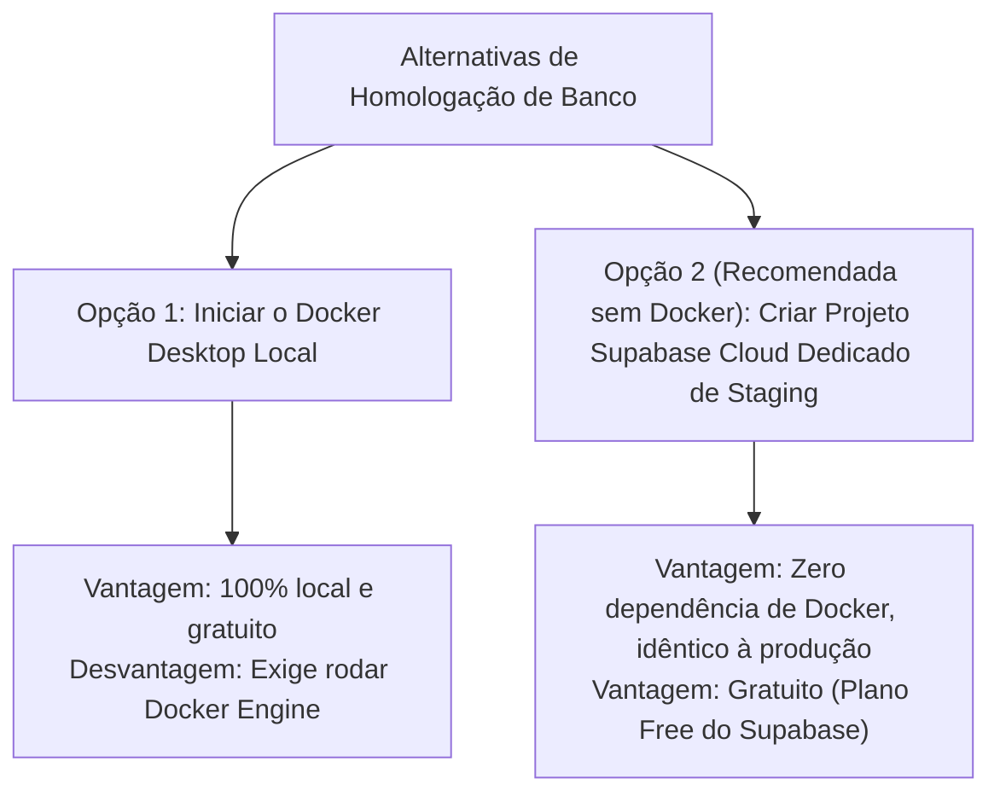

# MK9 DATE — ETAPA H3.12: PLANO DE HOMOLOGAÇÃO SEM DOCKER

**Data:** 18 de Outubro de 2026  
**Status do Módulo:** PLANEJAMENTO CONCLUÍDO (SEM PERSISTÊNCIA EM PRODUÇÃO)  
**Ambiente:** `C:\projetos\mk9-data`  
**Escopo:** Avaliação de alternativas sem Docker para testes de PostgreSQL real, triggers e RLS; requisitos, custos, segurança e plano dos testes.

---

## 1. Contexto e Diagnóstico das Alternativas

Na auditoria H3.11, constatou-se que o Docker Desktop está instalado no host Windows, mas seu serviço (`Docker Engine`) está parado. Para validar de ponta a ponta as garantias transacionais de banco (trigger de overlap com lock pessimista `FOR UPDATE`, concorrência e políticas de Row Level Security), existem duas abordagens viáveis:



### Por que a Opção 2 (Projeto Supabase Cloud Isolado) é a Recomendada?
1. **Zero Impacto em Produção:** Um projeto Supabase separado (ex.: `mk9-staging`) opera com banco Postgres totalmente isolado, sem compartilhar banco, chaves ou recursos.
2. **Paridade com a Produção:** Roda exatamente na mesma infraestrutura e versão de PostgreSQL (v17/v15), PostgREST e GoTrue que o projeto de produção.
3. **Sem Dependência de Docker:** Elimina necessidade de WSL2, virtualização ou recursos pesados de memória no Windows.

---

## 2. Requisitos, Custos e Limites a Confirmar

- **Custos:** **Zero (R$ 0,00)**. O plano gratuito (*Free Tier*) do Supabase permite criar até 2 projetos ativos simultâneos por conta (organização).
- **Atenção aos Limites do Free Tier:**
  - Caso a conta da organização já utilize 2 projetos gratuitos ativos, será necessário:
    - Pausar um projeto não utilizado; ou
    - Criar o projeto de testes em uma nova conta/organização de testes; ou
    - Verificar upgrade para o plano Pro caso a organização exija múltiplos projetos ativos.
- **Isolamento de Dados Sensíveis:** O projeto de staging **NÃO** deve receber dump de produção nem credenciais de produção. Todo o conteúdo será gerado por dados sintéticos.

---

## 3. Passos Manuais Necessários para Criar e Configurar o Staging

Caso opte pela criação do projeto Supabase Cloud para homologação, os passos manuais a serem executados pelo gestor/desenvolvedor são:

### Passo 1: Criar o Projeto no Painel do Supabase
1. Acessar [supabase.com/dashboard](https://supabase.com/dashboard).
2. Clicar em **"New Project"**.
3. Definir:
   - **Name:** `mk9-date-staging` (ou `mk9-homolog`).
   - **Database Password:** Criar uma senha forte exclusiva para o staging (guardar em segurança).
   - **Region:** `sa-east-1` (São Paulo) ou a mesma região de produção.
4. Aguardar o provisionamento (cerca de 2 minutos).

### Passo 2: Coletar as Chaves do Ambiente de Homologação
No painel do projeto em **Project Settings -> API**:
- Copiar a **Project URL** (`https://<staging-ref>.supabase.co`).
- Copiar a **anon / public key** (`eyJ...`).
> [!IMPORTANT]
> **NUNCA** copie ou armazene a `service_role` key na aplicação frontend. Utilize apenas a chave anônima pública.

### Passo 3: Configurar Variáveis de Ambiente Locais para Homologação
No repositório local, crie o arquivo `.env.staging` (adicionado ao `.gitignore`):
```env
VITE_SUPABASE_URL="https://<staging-ref>.supabase.co"
VITE_SUPABASE_PUBLISHABLE_KEY="eyJhbGciOiJIUzI1NiIsIn..."
```
*(Para rodar o app apontando para homologação, basta executar `npx vite --mode staging` ou renomear temporariamente para `.env.local` durante a sessão de testes).*

---

## 4. Ordem e Aplicação das Migrations no Projeto de Teste

No projeto de staging, as migrations podem ser aplicadas de duas formas:
- **Via Supabase CLI (Link Remoto de Staging):**
  ```powershell
  npx supabase link --project-ref <staging-ref>
  npx supabase db push
  ```
  *(O `db push` aplica automaticamente todas as migrations de `supabase/migrations/` em ordem cronológica).*
- **Via SQL Editor do Painel Supabase (Passo a Passo Manual):**
  1. Executar as migrations históricas até `20261016100000_create_supervisores_table.sql`.
  2. Executar `20261017120000_create_contratos_lojas_table.sql`.
  3. Executar `20261018150000_add_data_inicio_operacao_to_industrias.sql`.
  4. **NÃO EXECUTAR** o arquivo `supabase/migrations/propostas/20261018160000_proposal_sync_contratos_with_data_inicio.sql`.

---

## 5. Diferenciação dos Testes: Gratuitos sem Banco vs. Necessitam de Banco Ativo

| Cenário de Teste | Camada | Pode ser Testado sem Banco? | Como é Testado com Banco Ativo (Staging) |
| :--- | :--- | :---: | :--- |
| **Cálculo de Ciclo KING 23–22** | Regra Pura / Unitário | **SIM (100% Coberto)** | Já coberto pelos 81 testes automatizados em `contratosService.test.ts`. |
| **Cálculo Pro-Rata / Mês Cheio** | Regra Pura / Unitário | **SIM (100% Coberto)** | Já coberto pelos 81 testes automatizados em `contratosService.test.ts`. |
| **Sanitização de Payload e Schema** | Regra Pura / Unitário | **SIM (100% Coberto)** | Validado por `prepareContratoInsertData()` nos 81 testes. |
| **Validação de Valor por Visita $\le 0$** | Interface / Formulário | **SIM (100% Coberto)** | Validado no modal da UI (bloqueio antes do submit). |
| **Criação Real de Contrato Válido** | Integração (App + DB) | **NÃO** | Envia POST real para `contratos_lojas` via Supabase SDK; valida resposta 201 e retorno com joins de indústria e loja. |
| **Bloqueio de Overlap de Vigência** | PostgreSQL (Trigger) | **NÃO** | Tenta inserir registro colidindo com contrato ativo; valida se o Postgres aborta com código `P0001` e mensagem da trigger. |
| **Vigência Pós-Encerramento** | PostgreSQL (Trigger) | **NÃO** | Tenta inserir contrato após a data fim de um contrato `encerrado`; valida se a trigger aceita sem disparar exceção. |
| **Segurança e Isolamento RLS** | PostgREST / Políticas | **NÃO** | Tenta inserir/ler contratos autenticado como usuário de papel `promotor` ou `client_industry`; valida erro 403 / 42501. |
| **Concorrência Simultânea** | PostgreSQL (Pessimistic Lock) | **NÃO** | Dispara duas requisições paralelas simultâneas; valida se o `SELECT FOR UPDATE` na tabela `lojas` serializa com sucesso. |

---

## 6. Riscos e Mitigações

1. **Risco de Conectar à Produção por Engano:**
   - *Mitigação:* A URL do projeto e as chaves de staging possuem um `project-ref` completamente diferente do de produção. Ao inspecionar o Network do navegador, verificar que o domínio chamado é o de staging.
2. **Risco de Dados Reais em Staging:**
   - *Mitigação:* Criar apenas 2 indústrias sintéticas (`IND-013` e `IND-001`), 2 lojas (`LOJ-001` e `LOJ-002`) e usuários de teste (`gestor@teste.mk9`, `promotor@teste.mk9`).

---

## 7. Resultados da Validação Técnica Local

- `npx tsx --test src/lib/contratosService.test.ts`: **81 testes aprovados** (0 falhas).
- `npm run lint`: **0 erros** (`tsc --noEmit`).
- `npm run build`: **Compilação de produção concluída com sucesso**.
- **Git Status:** Repositório limpo; sem commits efetuados.
- **Confirmação Expressa:** Nenhuma persistência foi realizada no Supabase remoto de produção.

