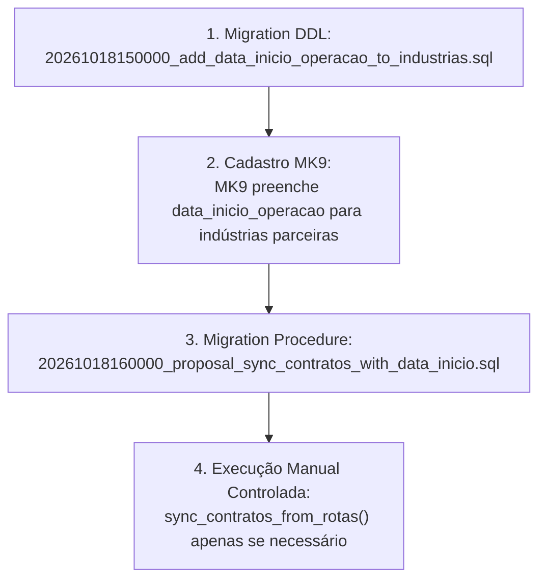

# RELATÓRIO TÉCNICO DE AUDITORIA — ETAPA H3.1
## Revisão Crítica da Proposta SQL e Análise de Garantias Transacionais

**Projeto:** MK9 Date (`C:\projetos\mk9-data`)  
**Data:** 18/10/2026  
**Status da Execução:** REVISÃO CRÍTICA / AUDITORIA PURAMENTE LOCAL (Sem execução de SQL, sem migrations aplicadas).

---

### 1. Problemas Encontrados na Primeira Proposta e Correções Implementadas

| # | Item Crítico | Problema Identificado na Revisão | Correção Aplicada |
|---|---|---|---|
| **1** | **KING sem data de início** | A proposta anterior mantinha `v_data_inicio := COALESCE(v_data_inicio, CURRENT_DATE)` para a KING (`IND-013`). Isso violava a diretriz de **nunca inventar datas via `CURRENT_DATE`**. | **Corrigido:** Removido o fallback. Se a KING (ou qualquer outra indústria) não tiver `data_inicio_operacao`, o contrato **não é criado** e o par é registrado em `rotas_sem_data_inicio_ignoradas`. O ciclo 23–22 é de apuração, não de início comercial. |
| **2** | **Ordem de Migrations & Checagem em Runtime** | Confiar em `information_schema.columns` dentro da procedure para executar dinamicamente o `SELECT` é uma ilusão de segurança: a procedure não deve ser implantada antes da tabela ter a coluna. Se a coluna não existir, nenhum contrato deve ser criado com datas de início inválidas. | **Corrigido:** Definido pré-requisito estrito: a migration `20261018150000_add_data_inicio_operacao_to_industrias.sql` DEVE ser aplicada antes. A proposta SQL não tenta contornar a ausência da coluna. |
| **3** | **Compatibilidade da Assinatura de Retorno** | A proposta adicionou a 4ª coluna `rotas_sem_data_inicio_ignoradas INTEGER`. | **Avaliação:** Em `contratosService.ts` (`runSyncFromRotas()`), o código lê `firstRow = Array.isArray(data) ? data[0] : data`, retornando o objeto de registro. A adição da coluna no SQL é compatível, mas o tipo TypeScript retornado em `runSyncFromRotas` precisará declarar `rotas_sem_data_inicio_ignoradas?: number` quando a migration for formalmente adotada. |

---

### 2. Análise Rigorosa de Garantias: Idempotência e Concorrência

#### 2.1. Idempotência em Execuções Sequenciais
- **Comprovada:** O bloco `IF EXISTS (SELECT 1 FROM public.contratos_lojas WHERE ... AND status IN ('ativo', 'suspenso')) THEN CONTINUE;` garante que, ao rodar a procedure consecutivamente, nenhum contrato duplicado é gerado.

#### 2.2. Proteção contra Corridas Concorrentes (Race Conditions)
- **O que é impedido:** O trigger `trigger_check_contratos_vigencia_overlap` executa `SELECT 1 FROM public.lojas WHERE codigo = NEW.loja_codigo FOR UPDATE`. Se duas transações tentarem inserir contratos para a mesma loja simultaneamente, a segunda transação é colocada em espera (`lock wait`) na linha da loja. Quando a primeira commita, a segunda lê a tabela `contratos_lojas` com os dados da primeira e dispara a exceção `Conflito de vigência contratual`.
- **O que permanece possível (NÃO COMPROVADO como 100% livre de contenção):**
  - Se a procedure `sync_contratos_from_rotas()` for disparada em paralelo por dois gestores ao mesmo tempo, ambas farão o loop completo de todas as rotas. A contenção de locks na tabela `public.lojas` causará aborto da transação inteira (`RAISE EXCEPTION` no trigger) para uma das sessões.
  - **Mitigação Recomendada:** A procedure deve ser executada apenas como comando administrativo singleton (ou via advisory lock: `SELECT pg_try_advisory_xact_lock(...)`).

#### 2.3. Restrição Única (UNIQUE Constraint)
- A tabela `public.contratos_lojas` **não possui** uma restrição `UNIQUE (industria_codigo, loja_codigo)`.
- Isso é **intencional e correto**, pois um mesmo par (indústria, loja) pode ter um contrato `encerrado` em 2025 e um novo contrato `ativo` em 2026. A unicidade temporal é controlada exclusivamente pelo trigger de sobreposição de vigências. Criar uma restrição `UNIQUE` simples quebraria o histórico legítimo.

---

### 3. Dependências e Ordem Obrigatória de Migração

A ordem de implantação deve ser rigidamente sequencial:

---

### 4. Testes de Banco Local Ainda Necessários (Classificados como Pendentes)

Como o ambiente atual não dispõe de um PostgreSQL local isolado e é proibido tocar no banco remoto, os seguintes testes de integração física permanecem **pendentes**:

1. **Teste de Bloqueio Concorrente:** Executar duas chamadas simultâneas de `sync_contratos_from_rotas()` em threads separadas para validar o comportamento de retry ou rollback.
2. **Teste de Transição de Status:** Inserir um contrato `encerrado` com término em `2026-06-30` e rodar a procedure para par com início em `2026-07-01` (confirmar sucesso) e em `2026-05-01` (confirmar bloqueio pelo trigger).
3. **Teste de Performance de Varredura:** Medir o tempo de execução do loop em uma base com 5.000 rotas ativas.

---

### 5. Decisões Comerciais que Ainda Faltam

1. **A procedure deve ser executada em produção?**  
   Com a criação da tela de **"Prévia de Contratos"** e a capacidade de criação pontual via formulário, a execução em lote da procedure pode nem ser necessária, evitando criação em massa de contratos indesejados.
2. **Qual a data de início da operação da KING?**  
   A MK9 precisa informar a `data_inicio_operacao` da KING no cadastro antes que qualquer contrato contínuo seja formalizado para ela via sincronização automática.

