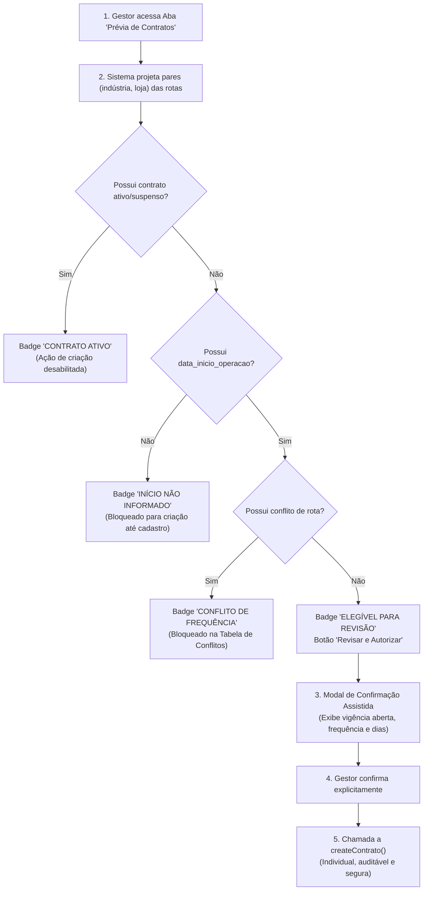

# RELATÓRIO DE AUDITORIA — ETAPA H3.2
## Fluxo Administrativo de Revisão e Autorização Individual de Contratos

**Projeto:** MK9 Date (`C:\projetos\mk9-data`)  
**Data:** 18/10/2026  
**Status da Execução:** AUDITORIA E DESENHO DE FLUXO (Sem persistência, sem execuções no banco de dados).

---

### 1. Arquivos e Componentes Inspecionados

1. **Interface do Usuário:**
   - `src/views/IndustriesView.tsx`: Aba *Prévia de Contratos*, seletores de filtro, agrupamento por rotas ativas e modal de edição/criação.
2. **Serviços e Regras de Negócio:**
   - `src/lib/contratosService.ts`: `analyzeRotasForContracts()`, `prepareContratoInsertData()`, `createContrato()`, `updateContrato()`, `runSyncFromRotas()`, `listContratos()`.
3. **Tipos e DTOs:**
   - `src/types.ts`: `ContratoLoja`, `CreateContratoLojaDTO`, `UpdateContratoLojaDTO`, `PeriodoContratual`, `IndustryItem`, `StoreItem`.
4. **Camada de Autorização e Políticas:**
   - `src/auth/AuthProvider.tsx`: `useAuth().hasPermission(['admin', 'gestor'])`.
   - `supabase/migrations/20261017120000_create_contratos_lojas_table.sql`: Políticas RLS de `INSERT` e `UPDATE` restritas a gestores e administradores, e trigger `trigger_check_contratos_vigencia_overlap`.

---

### 2. Diagnóstico dos Pontos de Entrada e Proteções Existentes

| Elemento | Estado Atual Comprovado | Lacunas Identificadas |
|---|---|---|
| **Aba Prévia de Contratos** | Somente leitura. Agrupa rotas ativas por loja e indústria, identifica conflitos de frequência e projeta o ciclo de apuração. | Não carrega contratos já existentes (`public.contratos_lojas`). Portanto, não sinaliza se o par (indústria, loja) já possui um contrato ativo ou suspenso. |
| **Exigência de Início de Operação** | Integrado em memória: sem `data_inicio_operacao`, o período fica `Não calculado` e a indústria é marcada como `Indisponível`. | Ajustado para aplicar-se estritamente inclusive à KING (`IND-013`), impedindo geração sem data de início formalizada. |
| **Preparação e Validação de DTOs** | `prepareContratoInsertData` valida frequências, visitas por semana, dias da semana e isola campos transitórios (`calcular_periodo`, `data_referencia`). | Já pronto e testado em TypeScript. Não executa mutações diretas sem aprovação. |
| **Controle de Acesso / RBAC** | `canEdit = hasPermission(['admin', 'gestor'])` protege modais e ações administrativas na interface. RLS barra tentativas não autorizadas no backend. | Seguro e consistente com as diretrizes do sistema. |
| **Prevenção de Duplicações e Conflitos** | Trigger de banco `trigger_check_contratos_vigencia_overlap` bloqueia sobreposições de vigências com lock pessimista na loja. | Falta exibir na interface visual o status do contrato existente (ex: "Já Contratado - Ativo"). |

---

### 3. Proposta do Futuro Fluxo Assistido (Sem Persistência Nesta Etapa)

Para evitar os riscos de criação cega em massa através de procedures batch, desenhou-se o seguinte fluxo de revisão item a item:

#### Requisitos do Modal de Confirmação Assistida (Proposta Futura):
1. **Resumo Visual Claro:** Exibe Indústria, Loja, Frequência consolidada, Dias de visita e Data de início comercial.
2. **Declaração de Vigência Comercial Aberta:** Deixa explícito ao gestor que `data_fim_vigencia` será `NULL` (contrato contínuo) e que o ciclo de apuração é apenas a regra contábil periódica.
3. **Feedback Imediato por Linha:** Após a autorização futura, o item na tabela atualiza seu badge para `Contrato Criado` sem recarregar a tela inteira.
4. **Sem Ações em Massa Cegas:** Nenhum botão "Criar Todos" que possa inadvertidamente violar regras contratuais.

---

### 4. Diferença Rigorosa: O que foi Verificado vs. O que é Proposta

- **VERIFICADO E COMPROVADO:**
  - Código fonte inspecionado em `IndustriesView.tsx`, `contratosService.ts` e `types.ts`.
  - Nenhuma gravação ocorre atualmente pela aba de prévia.
  - A validação de DTOs rejeita criações sem data de início para indústrias não KING e KING quando acionado o cálculo de período.
  - 66 testes unitários continuam passando com sucesso total.
- **PROPOSTA (NÃO IMPLEMENTADA NESTA ETAPA):**
  - Consulta aos contratos existentes em `contratos_lojas` dentro da prévia para pintar badges de "Já Contratado".
  - Botão e modal de autorização assistida individual.

---

### 5. Recomendação para a Próxima Etapa

1. Permitir que a aba de prévia realize consulta somente leitura à tabela `contratos_lojas` (via `listContratos()`) para confrontar os pares com contratos já existentes.
2. Manter a sincronização em lote desativada em produção, adotando a autorização assistida individual como padrão operacional homologado pela MK9.

