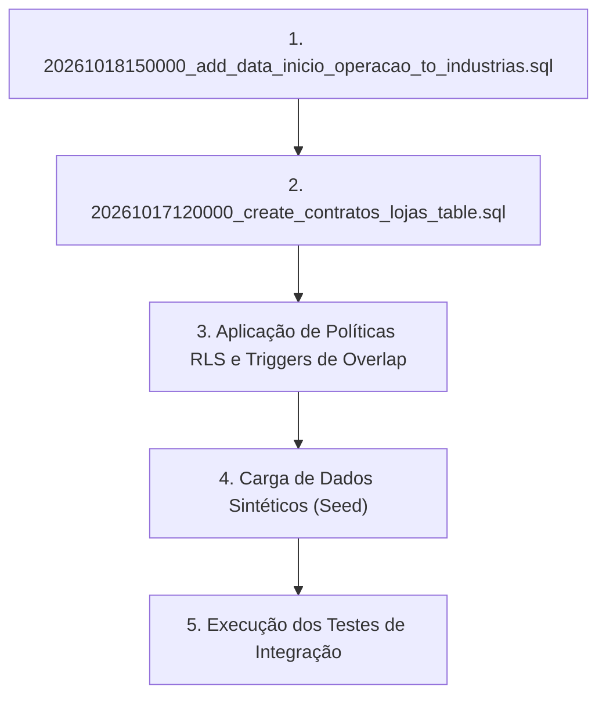

# MK9 DATE — ETAPA H3.9: PREPARAÇÃO SEGURA PARA HOMOLOGAÇÃO

**Data:** 18 de Outubro de 2026  
**Status do Módulo:** AUDITADO E PREPARADO PARA HOMOLOGAÇÃO ISOLADA  
**Ambiente Auditado:** Local (`C:\projetos\mk9-data`)  
**Banco de Produção Remoto:** 100% PRESERVADO E INTOCADO  

---

## 1. Diagnóstico do Ambiente de Staging

### 1.1. Inspeção de Configurações e Arquivos de Ambiente
- Foram inspecionados os arquivos de configuração de ambiente no repositório:
  - `.env.example`: Modelo documentado apontando para variáveis padrão do Vite.
  - `.env.local`: Aponta diretamente para as variáveis `VITE_SUPABASE_URL` e `VITE_SUPABASE_PUBLISHABLE_KEY` do ambiente ativo (projeto principal de produção).
- **Diagnóstico:** **Não existe atualmente um projeto Supabase de staging / homologação configurado no repositório**. Não há arquivos `.env.staging`, `.env.test` ou branch de infraestrutura separada para banco de dados isolado.

### 1.2. Como Preparar um Ambiente Isolado Seguro (Sem Expor Produção)
Para homologar a criação e conciliação de contratos sem risco à base operacional:
1. **Criar um Projeto Supabase Dedicado (Ex: `mk9-staging`):**
   - Criar um novo projeto gratuito ou instância Docker local via Supabase CLI (`supabase start`).
   - Obter a `VITE_SUPABASE_URL` e `VITE_SUPABASE_PUBLISHABLE_KEY` exclusivas desta instância de staging.
2. **Isolamento de Credenciais:**
   - Criar arquivo `.env.staging` (adicionado ao `.gitignore`).
   - **NUNCA** copiar dumps com CPFs, dados de promotores ou senhas reais de produção.
3. **Seed de Dados Sintéticos Mínimos:**
   - Inserir algumas linhas fictícias em `public.industrias` (ex: `IND-013` King, `IND-001` Teste com `data_inicio_operacao = '2026-10-01'`).
   - Inserir lojas fictícias em `public.lojas` (ex: `LOJ-001`, `LOJ-002`).
   - Inserir rotas de teste em `public.rotas` para alimentar a prévia.

---

## 2. Ordem Segura de Implantação das Migrations no Ambiente de Staging

Ao inicializar o banco de homologação, as migrations devem ser executadas **estritamente nesta sequência de dependência**:



1. **Passo 1:** `supabase/migrations/20261018150000_add_data_inicio_operacao_to_industrias.sql`
   - Adiciona a coluna `data_inicio_operacao DATE NULL` em `industrias`.
   - *Dependência:* Necessária para que a tabela `industrias` suporte o marco inicial da operação antes de vincular contratos.
2. **Passo 2:** `supabase/migrations/20261017120000_create_contratos_lojas_table.sql`
   - Cria a tabela `public.contratos_lojas` com foreign keys para `industrias(codigo)` e `lojas(codigo)`.
   - Cria a trigger `trigger_check_contratos_vigencia_overlap` com lock pessimista (`FOR UPDATE`).
   - Cria a trigger `trigger_contratos_updated_at`.
   - Habilita RLS com políticas restritas para `authenticated` (`admin`, `gestor`, `operador`, `promotor`, `client_industry`).
3. **Passo 3 (Opcional / Proposta Isolada):** `supabase/migrations/propostas/20261018160000_proposal_sync_contratos_with_data_inicio.sql`
   - *Atenção:* **NÃO EXECUTAR**. A procedure de sincronização em lote permanece isolada na pasta `propostas/` e só deve ser avaliada após a homologação completa da autorização individual.

---

## 3. Roteiro Detalhado de Testes de Integração para Homologação

| Cenário de Teste | Dados de Entrada / Condição | Comportamento Esperado | Status / Camada |
| :--- | :--- | :--- | :--- |
| **1. Criação Válida (Pro-Rata Comum)** | Indústria `IND-001` (`data_inicio_operacao = '2026-10-15'`), Loja `LOJ-001`, `frequencia = 'SEMANAL'`, `valor_por_visita = 120.00`, vigência contínua. | Inserção bem-sucedida em `contratos_lojas`, `data_inicio_vigencia = '2026-10-15'`, `data_fim_vigencia = null`, `status = 'ativo'`. Retorna dados com join de loja e indústria. | Pronto para Staging |
| **2. Rejeição de Valor Inválido na UI** | Tentativa de submissão com valor `0.00`, `-50.00` ou vazio no modal. | Bloqueio imediato no frontend com mensagem: *"Informe um valor por visita válido e maior que zero (R$)"*. Nenhuma requisição enviada ao backend. | Validado localmente |
| **3. Rejeição de Sobreposição Temporal** | Tentativa de criar contrato ativo para `IND-001` + `LOJ-001` com início em `2026-10-20`, existindo contrato ativo cobrindo o período. | Trigger de banco aborta transação com exceção `Conflito de vigência contratual: já existe contrato ativo ou suspenso...`. | Garantido pela Trigger SQL |
| **4. Nova Vigência Pós-Encerramento** | `IND-001` + `LOJ-001` possui contrato anterior com `status = 'encerrado'` e `data_fim_vigencia = '2026-09-30'`. Novo contrato com início em `2026-10-01`. | Inserção aceita sem erro. Trigger não bloqueia contratos com status `encerrado`. | Validado localmente |
| **5. Contrato Contínuo KING (`IND-013`)** | Indústria `IND-013`, Loja `LOJ-002`, `frequencia = 'SEMANAL'`, vigência contínua. | `data_fim_vigencia` gravado estritamente como `NULL`. Ciclo 23 a 22 preservado apenas na memória de apuração. | Validado localmente |
| **6. Bloqueio de Perfil Não Autorizado** | Requisição `INSERT` em `contratos_lojas` autenticado como usuário de perfil `promotor` ou `client_industry`. | Bloqueio imediato por RLS (`contratos_lojas_insert_policy`), retornando erro HTTP 403 / PostgREST error `42501`. | Garantido pelas Policies RLS |
| **7. Concorrência Simultânea (Pessimistic Lock)** | Dois gestores clicam em aprovar para o mesmo par `IND-001` + `LOJ-001` no mesmo milissegundo. | O `SELECT 1 FROM lojas WHERE codigo = ... FOR UPDATE` serializa as transações. O primeiro conclui com sucesso; o segundo recebe o erro de overlap da trigger e falha com segurança. | Garantido pelo Lock Postgres |

---

## 4. Análise de Tratamento de Erros da Trigger em `createContrato()`

Inspecionamos a função `createContrato()` em [contratosService.ts](file:///c:/projetos/mk9-data/src/lib/contratosService.ts):
```typescript
try {
  const { data, error } = await supabase
    .from('contratos_lojas')
    .insert(prepared.data)
    .select(...)
    .single();

  if (error) {
    if (isTableNotFoundError(error)) {
      return { data: null, error: new MigrationPendingError(), isMigrationPending: true };
    }
    throw error;
  }
  return { data: data as unknown as ContratoLoja, error: null };
} catch (err: any) { ... }
```
- **Achado:** Quando a trigger `trigger_check_contratos_vigencia_overlap` dispara um `RAISE EXCEPTION`, o Supabase retorna um objeto de erro com `code = 'P0001'` e a mensagem:
  *"Conflito de vigência contratual: já existe contrato ativo ou suspenso (ID ...) para a indústria ... e loja ... no período informado."*
- **Aderência:** O erro é propagado no campo `error` do retorno de `createContrato()`.
- **Recomendação para a Etapa de Ativação:** Na interface que chamar `createContrato()`, interceptar especificamente a mensagem de conflito de vigência para exibir um Toast de alerta explicativo (ex: *"Esta loja já possui um contrato ativo ou suspenso para este período. Atualize a lista."*) em vez de um erro genérico.

---

## 5. Decisões Administrativas Pendentes

1. **Flexibilidade do DTO vs. Obrigatoriedade da UI:**
   - **Situação:** A UI de autorização individual exige estritamente `valor_por_visita > 0`. O DTO e a função de sanitização `prepareContratoInsertData()` aceitam `null` ou `undefined`.
   - **Recomendação:** **Manter o DTO flexível**. Isso permite que futuras migrações em lote ou integrações aceitem contratos provisórios com valor sob negociação, enquanto o modal administrativo da UI mantém a trava de segurança exigindo valor positivo.
2. **Sincronização em Lote (`sync_contratos_from_rotas`):**
   - Deve permanecer congelada e desativada. Nenhuma chamada de procedure deve ser liberada antes que a autorização individual esteja homologada e operando com sucesso em staging.
3. **Criação de Instância de Staging:**
   - A equipe técnica da MK9 deve aprovar a criação de um projeto Supabase de homologação com chaves próprias para a realização dos testes práticos.

---

## 6. Estado do Repositório Git e Alterações Locais

- **Estado do Git:** O repositório está limpo (`working tree clean`). Todas as implementações das etapas anteriores foram comitadas no commit `c010ea0` (`feat: add freelancers view, contracts service, and database migration for startup dates`).
- **Alterações não relacionadas preservadas:** Os arquivos `src/views/DailiesControlView.tsx` e `src/views/FreelancersView.tsx` foram preservados integralmente sem reversões ou perdas de código.
- **Nenhum novo commit foi criado nesta etapa**.

---

## 7. Evidências de Validação Técnica Local

- `npx tsx --test src/lib/contratosService.test.ts`: **81 testes aprovados** (22 suites, 0 falhas).
- `npm run lint`: **0 erros** (`tsc --noEmit`).
- `npm run build`: **Compilação de produção concluída com sucesso** (`vite build` gerou artefatos em `dist/`).
- **Garantia de Não Persistência:** Nenhuma migration, query SQL ou chamada a `createContrato()` foi disparada no Supabase de produção.

