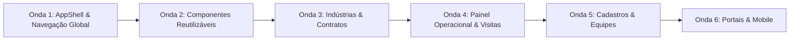

# MK9 DATE — INVENTÁRIO COMPLETO E PLANO DE MODERNIZAÇÃO UX/UI

**Data:** 18 de Outubro de 2026  
**Documento:** Inventário de Páginas, Auditoria de Experiência e Arquitetura de Navegação  
**Status:** Fase 1 Concluída (Diagnóstico & Planejamento Estratégico) — Aguardando Aprovação para Implementação Controlada

---

## 1. Resumo Executivo e Diagnóstico Geral

O **MK9 Date — Trade Marketing Operation** é um sistema maduro, robusto e rico em regras comerciais complexas (controle de ponto, aderência de promotores, roteirização quinzenal/semanal, conciliação contratual, telemetria fotográfica com GPS e relatórios executivos).

Atualmente, o sistema conta com **19 telas/views distintas**, organizadas em um menu lateral com 16 itens visíveis simultaneamente para o Administrador.
Apesar da alta capacidade técnica, a plataforma apresenta desafios ergonômicos típicos de sistemas corporativos em expansão:
- **Sobrecarga Cognitiva:** Telas monolíticas com múltiplas responsabilidades (ex: `IndustriesView.tsx` com 2.678 linhas contendo cadastro, métricas de visitas, aderência de promotores, contratos e conciliação).
- **Dispersão de Navegação:** Operações complementares separadas em telas isoladas sem fluxo guiado (ex: criar rota, checar presença, acompanhar visita e aprovar diária exigem alternar 4 páginas distintas).
- **Tabelas com Densidade Excessiva:** Listagens longas sem paginação real, renderizando centenas de nós DOM com layouts fixos pouco amigáveis ao mobile/tablet.
- **Identidade Visual Fragmentada:** Coexistência de paletas herdadas (botões roxos/índigo em algumas telas, enquanto a base institucional é preto `#111114`, cinza neutro `#EAE8E2` e azul MK9 `#286FF5`).

---

## 2. Inventário Completo das Telas e Módulos (Fase 1)

Abaixo está o mapeamento detalhado das **19 views existentes no código**:

### Grupo A — Visão Geral & Cockpits
1. **Cockpit (`cockpit`)**
   - **Arquivo:** `src/views/CockpitView.tsx` (734 linhas)
   - **Objetivo Principal:** Visão consolidada em tempo real da operação MK9 (promotores ativos, lojas, rotas, faltas, presenças, financeiro).
   - **Perfis de Usuário:** `admin`, `gestor`, `operador`.
   - **Ação Mais Importante:** Monitorar KPIs e identificar anomalias recentes.
   - **Problemas Identificados:** Carrega muitas contagens simultâneas; feed de atividades recente é extenso; filtros de período (today/week/month) nem sempre refletem nos gráficos.

2. **Painel Operacional (`painel-operacional`)**
   - **Arquivo:** `src/views/OperationalDashboardView.tsx` (3.181 linhas)
   - **Objetivo Principal:** Centro nervoso de monitoramento diário: alertas críticos, pendências de visitas, ocorrências de rupturas e validades.
   - **Perfis de Usuário:** `admin`, `gestor`, `operador`.
   - **Ação Mais Importante:** Resolver pendências e despachar promotores.
   - **Problemas Identificados:** Extremamente monolítico; excesso de abas internas e sub-filtros; tabela com densidade pesada de informações.

---

### Grupo B — Operação de Campo & Visitas
3. **Acompanhamento de Visitas (`acompanhamento-visitas`)**
   - **Arquivo:** `src/views/VisitsTrackingView.tsx` (1.454 linhas)
   - **Objetivo Principal:** Rastreamento tático de visitas do dia, check-in, check-out, fotos de gôndola, pesquisa de preço e checklist.
   - **Perfis de Usuário:** `admin`, `gestor`, `operador`.
   - **Ação Mais Importante:** Auditar a execução em loja com fotos e coordenadas GPS.
   - **Problemas Identificados:** Filtro triplo (Supervisor, Equipe, Promotor) ocupa muito espaço; cards de fotos podem sobrecarregar a memória em conexões lentas.

4. **Controle de Presença (`presenca`)**
   - **Arquivo:** `src/views/AttendanceControlView.tsx` (863 linhas)
   - **Objetivo Principal:** Telemetria de assiduidade dos promotores (presente, falta, atestado, sem registro).
   - **Perfis de Usuário:** `admin`, `gestor`, `operador`.
   - **Ação Mais Importante:** Ajustar presença e registrar justificativas ou atestados médicos.
   - **Problemas Identificados:** Modal de justificativa manual poderia ser integrado a um fluxo rápido de inline-edit; falta visualização em calendário mensal.

5. **Portal do Promotor (`portal-promotor`)**
   - **Arquivo:** `src/views/PromoterPortalView.tsx` (3.712 linhas)
   - **Objetivo Principal:** Interface mobile/PWA do promotor em campo: check-in geolocalizado, checklist de tarefas, fotos de antes/depois, rupturas e pesquisas.
   - **Perfis de Usuário:** `promotor` (visão exclusiva), `admin`, `gestor`, `operador` (visão espelhada/supervisão).
   - **Ação Mais Importante:** Realizar check-in, executar a visita e finalizar com assinatura.
   - **Problemas Identificados:** Arquivo gigantesco; complexidade de estados para visitas pendentes de dias anteriores; botões na visualização mobile precisam de zonas de toque maiores.

---

### Grupo C — Roteirização, Indústrias & Lojas
6. **Rotas Fixas (`rotas-fixas`)**
   - **Arquivo:** `src/views/RoutesView.tsx` (1.464 linhas)
   - **Objetivo Principal:** Criação e manutenção da malha logística de rotas (indústria, loja, promotor, dias da semana, frequência semanal/quinzenal).
   - **Perfis de Usuário:** `admin`, `gestor`, `operador`.
   - **Ação Mais Importante:** Cadastrar e otimizar roteiros de atendimento.
   - **Problemas Identificados:** Seleção de dias da semana e ciclo quinzenal pode ser confusa; falta visualização em mapa ou agrupamento por PDV.

7. **Gestão de Indústrias (`industrias`)**
   - **Arquivo:** `src/views/IndustriesView.tsx` (2.698 linhas)
   - **Objetivo Principal:** Gestão de marcas atendidas, histórico de aderência, cadastro com `data_inicio_operacao` e autorização de contratos comerciais.
   - **Perfis de Usuário:** `admin`, `gestor` (com escrita/autorização), `operador` (somente leitura).
   - **Ação Mais Importante:** Formalizar contratos e acompanhar cumprimento do plano.
   - **Problemas Identificados:** Concentra 3 domínios completamente diferentes em abas (Aderência Operacional, Cadastro Comercial e Prévia de Contratos). A aba de contratos merece destaque ou visão dedicada.

8. **Lojas / PDVs (`lojas`)**
   - **Arquivo:** `src/views/StoresView.tsx` (649 linhas)
   - **Objetivo Principal:** Cadastro de redes e pontos de venda (CNPJ, endereço, cidade, UF, status).
   - **Perfis de Usuário:** `admin`, `gestor`, `operador`.
   - **Ação Mais Importante:** Cadastrar e localizar lojas para inclusão em rotas.
   - **Problemas Identificados:** Tabela longa sem paginação eficiente; falta integração direta com visualização de rotas ativas na própria loja.

---

### Grupo D — Gestão de Pessoas & Equipes
9. **Promotores (`promotores`)**
   - **Arquivo:** `src/views/PromotersView.tsx` (1.200 linhas)
   - **Objetivo Principal:** Cadastro de promotores de campo (matrícula, dados contratuais, equipe, supervisor, contato).
   - **Perfis de Usuário:** `admin`, `gestor`, `operador`.
   - **Ação Mais Importante:** Cadastrar promotor e vincular à equipe/supervisor.
   - **Problemas Identificados:** Tabela extensa; formulário de cadastro possui muitos campos lineares sem separação visual por etapas.

10. **Gestão de Equipes (`gestao-equipes`)**
    - **Arquivo:** `src/views/TeamsManagementView.tsx` (1.936 linhas)
    - **Objetivo Principal:** Agrupamento de promotores por esquadrões (squads), regiões e cobertura de atendimento.
    - **Perfis de Usuário:** `admin`, `gestor`, `operador`.
    - **Ação Mais Importante:** Montar e balancear equipes de campo.
    - **Problemas Identificados:** Interface densa com múltiplos seletores repetidos.

11. **Gestão de Supervisores (`supervisores`)**
    - **Arquivo:** `src/views/SupervisorsManagementView.tsx` (846 linhas)
    - **Objetivo Principal:** Vinculação de supervisores responsáveis por equipes e promotores.
    - **Perfis de Usuário:** `admin`, `gestor`, `operador`.
    - **Ação Mais Importante:** Definir líderes regionais e sua hierarquia de subordinação.
    - **Problemas Identificados:** Tela com baixa frequência de uso que ocupa espaço de destaque de primeiro nível no menu principal.

12. **Freelancers (`freelancers`)**
    - **Arquivo:** `src/views/FreelancersView.tsx` (1.026 linhas)
    - **Objetivo Principal:** Banco de talentos e promotores temporários para cobertura de faltas e campanhas sazonais.
    - **Perfis de Usuário:** `admin`, `gestor`, `operador`.
    - **Ação Mais Importante:** Alocar freelancer para suprir ausência de promotor CLT.
    - **Problemas Identificados:** Desconectada do fluxo de justificativa de falta do Controle de Presença.

---

### Grupo E — Financeiro & Auditoria
13. **Controle de Diárias (`controle-diarias`)**
    - **Arquivo:** `src/views/DailiesControlView.tsx` (950 linhas)
    - **Objetivo Principal:** Apuração de diárias a pagar (especialmente freelancers e promotores por demanda), valores por visita e confirmação de pagamento.
    - **Perfis de Usuário:** `admin`, `gestor`, `operador`.
    - **Ação Mais Importante:** Conferir e aprovar borderô de diárias operacionais.
    - **Problemas Identificados:** Falta exportação rápida para financeiro/contabilidade e conciliação com os contratos homologados.

---

### Grupo F — Portais Externos & Clientes
14. **Portal da Indústria (`portal-industria`)**
    - **Arquivo:** `src/views/IndustryPortalView.tsx` (2.975 linhas)
    - **Objetivo Principal:** Portal de transparência para as indústrias clientes acompanharem execução, relatórios executivos, fotos em tempo real e gráficos de sell-in/sell-out.
    - **Perfis de Usuário:** `client_industry` (visão restrita à sua marca via RLS), `admin`, `gestor` (visão consolidada ou simulada).
    - **Ação Mais Importante:** Exportar relatórios em Excel/PDF e auditar presença nos pontos de venda.
    - **Problemas Identificados:** Muitos subpainéis sobrecarregados; relatórios demoram para compor quando há muitas fotos no período.

---

### Grupo G — Administração, Configurações & Utilidades
15. **Perfis & Permissões (`usuarios`)**
    - **Arquivo:** `src/views/UsersPermissionsView.tsx` (1.750 linhas)
    - **Objetivo Principal:** Gestão de usuários, senhas, vínculos de matrícula/indústria e controle de permissões por papel.
    - **Perfis de Usuário:** `admin` (exclusivo).
    - **Ação Mais Importante:** Criar novos usuários e definir seus privilégios de acesso.
    - **Problemas Identificados:** Tabela longa; edição de papéis requer atenção redobrada quanto a RLS.

16. **Importação de Planilhas (`importacao`)**
    - **Arquivo:** `src/views/ImportView.tsx` (970 linhas)
    - **Objetivo Principal:** Carga em lote de promotores, lojas e rotas via arquivos Excel (.xlsx).
    - **Perfis de Usuário:** `admin`, `gestor`.
    - **Ação Mais Importante:** Ingestão de dados legados ou planilhas de clientes.
    - **Problemas Identificados:** Falta validação prévia com prévia de erros em linha antes de disparar o commit.

17. **Design System & Identidade (`design-system`)**
    - **Arquivo:** `src/views/DesignSystemView.tsx` (261 linhas)
    - **Objetivo Principal:** Catálogo visual de tokens, cores, badges e convenções visuais do sistema.
    - **Perfis de Usuário:** `admin`, `gestor`, `operador` (ferramenta técnica/desenvolvimento).
    - **Ação Mais Importante:** Consultar padrões de interface e códigos hexadecimais.
    - **Problemas Identificados:** Tela técnica exposta como item de navegação principal no menu lateral.

18. **Meu Perfil (`meu-perfil`)**
    - **Arquivo:** `src/views/ProfileView.tsx` (580 linhas)
    - **Objetivo Principal:** Edição de dados do usuário logado, alteração de senha e visualização de credenciais.
    - **Perfis de Usuário:** Todos os perfis autenticados.
    - **Ação Mais Importante:** Atualizar dados cadastrais e senha.

---

## 3. Proposta de Nova Arquitetura de Navegação (Fase 2)

Em vez de listar 16 a 18 opções em texto corrido na barra lateral, propomos reorganizar a navegação em **Áreas de Trabalho Claras com Submenus Hierárquicos**, adaptados aos papéis de usuário reais:

```mermaid
flowchart TD
    Shell["AppShell Modernizado"] --> VisaoGeral["1. Visão Geral"]
    Shell --> Operacao["2. Operação & Visitas"]
    Shell --> Roteirizacao["3. Roteiros & Frequências"]
    Shell --> Cadastros["4. Redes & Parceiros"]
    Shell --> Equipes["5. Pessoas & Equipes"]
    Shell --> Financeiro["6. Financeiro & Diárias"]
    Shell --> Portais["7. Portais Dedicados"]
    Shell --> Admin["8. Configurações & Acessos"]

    VisaoGeral --> Cockpit["Cockpit Executivo"]
    VisaoGeral --> PainelOps["Painel de Ocorrências & Alertas"]

    Operacao --> AcompVisitas["Acompanhamento em Tempo Real"]
    Operacao --> Presenca["Controle de Assiduidade"]

    Roteirizacao --> RotasFixas["Malha de Rotas"]
    Roteirizacao --> Contratos["Contratos & Frequências"]

    Cadastros --> Lojas["Lojas / PDVs"]
    Cadastros --> Industrias["Indústrias & Marcas"]

    Equipes --> Promotores["Promotores CLT"]
    Equipes --> Freelancers["Banco de Freelancers"]
    Equipes --> GestaoEquipes["Equipes & Supervisores"]

    Financeiro --> Diarias["Controle de Diárias"]

    Portais --> PortalPromotor["Portal do Promotor (PWA)"]
    Portais --> PortalIndustria["Portal da Indústria (Cliente)"]

    Admin --> Importacao["Importador de Planilhas"]
    Admin --> Usuarios["Perfis & Permissões"]
    Admin --> DesignSystem["Design System (Técnico)"]
    Admin --> MeuPerfil["Meu Perfil"]
```

### Melhorias Estruturais na Navegação:
1. **Menu Lateral Recolhível (Collapsible):**
   - Modo expandido (260px) com rótulos e agrupamentos.
   - Modo compacto (72px) apenas com ícones e tooltips flutuantes elegantes, maximizando a área de dados para tabelas no desktop.
2. **Submenus Agrupados e Breadcrumbs:**
   - Reduz de 16 para 8 blocos lógicos principais, diminuindo a poluição visual em 50%.
   - Adiciona trilha de navegação (Breadcrumbs) no topo: *Ex: Início > Roteiros > Contratos*.
3. **Busca Rápida Omnibox (Ctrl+K / Cmd+K):**
   - Já suportada pelo motor existente; modernizá-la com atalhos diretos para páginas, além de entidades.
4. **Respeito Integral às Permissões RLS:**
   - Promotores continuam com rota travada em `portal-promotor`.
   - Clientes continuam restritos ao `portal-industria`.
   - Operadores e Gestores visualizam somente as áreas que possuem permissão de acesso.

---

## 4. Padrão Unificado de Design System (Fase 6)

Para eliminar disparidades visuais entre telas sem refazer o CSS do zero, o design system oficial do MK9 Date será estritamente balizado pelos tokens documentados:

### 4.1 Cores e Contrastes Corporativos
- **Canvas / Fundo:** `#EAE8E2` (Areia suave/warm gray institucional, eliminando o cansaço do branco puro).
- **Cards & Superfícies:** `#F7F6F2` (Superfície limpa com borda sutil `#CFCDC5`).
- **Headers de Tabelas e Inputs:** `#E4E2DB` (Fundo neutro com borda definida).
- **Texto Principal:** `#171717` (Contraste 12:1 em conformidade estrita com WCAG AAA).
- **Texto Secundário / Labels:** `#737373` ou `#5F5F5F` (Contraste 5.5:1, legível e não ofuscante).
- **Acentos Significativos (Signifiers):**
  - **Primário:** `#111114` (Preto premium para ações principais/CTAs).
  - **Institucional:** `#286FF5` (Azul MK9 para destaques, links e tabs ativas).
  - **Sucesso:** `#16845B` / `#E8F5EE` (Verde para check-ins concluídos e contratos ativos).
  - **Atenção:** `#D98A00` / `#FFF8E6` (Âmbar para pendências e contratos suspensos).
  - **Erro / Alerta:** `#D93636` / `#FDF2F2` (Vermelho para rupturas, atrasos e vigências conflitantes).

---

## 5. Plano de Implementação Gradual em 6 Ondas (Fase 9)

### Detalhamento das Etapas de Execução:

- **Onda 1 — Navegação Global & AppShell:**
  - Implementar sidebar colapsável com transição fluida e subgrupos lógicos.
  - Adicionar Breadcrumbs contextuais no cabeçalho.
  - Refinar o seletor de perfil e o modal de busca `Ctrl+K`.
  - *Critério de Aceite:* Não quebrar nenhuma rota atual; passar em 81 testes, lint e build.

- **Onda 2 — Componentes Compartilhados do Design System (`src/components/common`):**
  - `DataTable`: Tabela padronizada com busca integrada, contagem de registros, ordenação por coluna e paginação configurável (10, 25, 50 itens).
  - `StatCard`: Cards de KPIs com indicador de tendência e ícones padronizados.
  - `StatusBadge`: Badges semânticos acessíveis com alto contraste.
  - `ActionModal`: Padrão consistente de janelas de diálogo e confirmação.

- **Onda 3 — Modernização do Módulo de Indústrias & Contratos (`IndustriesView.tsx`):**
  - Desacoplar a tela em abas mais limpas, separando o cadastro da telemetria e da gestão de contratos.
  - Aplicar o componente `DataTable` na aba de Contratos para evitar listagens infinitas.
  - Refinar o modal de revisão de contratos já aprovado nas etapas H3.15-H3.20.

- **Onda 4 — Otimização do Painel Operacional & Acompanhamento de Visitas:**
  - Reduzir o ruído visual no `OperationalDashboardView.tsx`.
  - Agrupar alertas por criticidade com filtros rápidos em formato de pílulas (*chips*).
  - Melhorar o preview de fotos e ocorrências em loja.

- **Onda 5 — Padronização de Lojas, Promotores e Equipes:**
  - Incorporar filtros com busca rápida nas telas de Lojas e Promotores.
  - Melhorar formulários de cadastro com divisão em blocos (Identificação, Contato, Alocação).

- **Onda 6 — Refinamento Mobile e Portais Externos:**
  - Ajustar visualização do `PromoterPortalView` para telas pequenas de smartphones.
  - Otimizar carregamento e exportação de relatórios no `IndustryPortalView`.

---

## 6. Riscos, Mitigações e Critérios de Homologação

1. **Risco de Quebra de Permissões (RLS):**
   - *Mitigação:* A navegação continuará validando `hasPermission()` em tempo de renderização e consumindo serviços com cliente autenticado. Nenhuma query de backend será alterada.
2. **Risco de Desorientação do Usuário:**
   - *Mitigação:* Os identificadores das telas (`ScreenId`) e as rotas internas permanecem idênticos. O usuário encontrará todas as funcionalidades anteriores no mesmo endereço lógico.
3. **Preservação de Dados e Migrations:**
   - *Mitigação:* Nenhuma migration será alterada; nenhum comando destrutivo no banco local ou remoto será executado.
4. **Verificação Obrigatória a Cada Entrega:**
   - Testes unitários (`npx tsx --test src/lib/contratosService.test.ts`): 81/81 testes.
   - Lint TypeScript (`npm run lint`): 0 erros.
   - Build de produção (`npm run build`): Sucesso sem erros de compilação.

