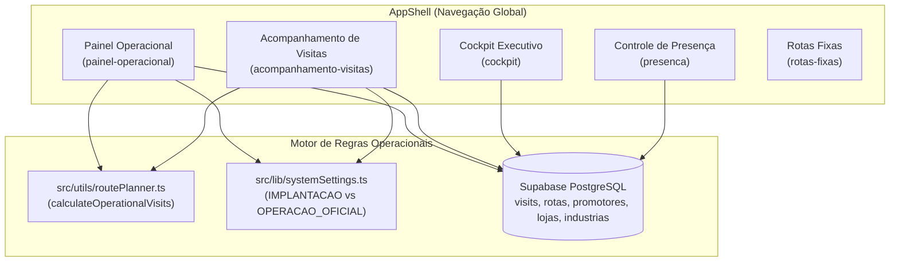

# MK9 DATE — ONDA 4.1: RELATÓRIO DE AUDITORIA COMPLETA DO PAINEL OPERACIONAL

**Data da Auditoria:** 18/10/2026  
**Status do Módulo:** Concluído — Diagnóstico e Planejamento  
**Objetivo:** Mapeamento técnico, funcional, visual e de arquitetura do Painel Operacional e telas satélites de telemetria antes da modernização.  
**Regra Estrita Aplicada:** Exclusivamente auditoria e planejamento. Nenhum código de produção ou banco de dados foi alterado nesta etapa.

---

## 1. INTRODUÇÃO E ESCOPO DA AUDITORIA

O módulo operacional do **MK9 Date** é o coração da plataforma de Trade Marketing, responsável por conectar em tempo real as diretrizes de roteirização aos atendimentos em campo executados pelos promotores. 

A presente auditoria investigou minuciosamente os arquivos responsáveis pelo ecossistema operacional:
1. `src/views/OperationalDashboardView.tsx` (3.181 linhas, ~156 KB): Centro de comando e telemetria operacional com cálculo em tempo real de conformidade, alertas, pendências e ocorrências.
2. `src/views/VisitsTrackingView.tsx` (1.454 linhas, ~64 KB): Acompanhamento individual e granular de visitas com suporte a escopo hierárquico (Supervisores vs Gestores).
3. `src/views/CockpitView.tsx` (734 linhas, ~36 KB): Cockpit executivo / C-Level com métricas gerais de rede, equipes e diárias.
4. `src/views/AttendanceControlView.tsx` (733 linhas, ~43 KB): Controle de frequência, jornada de trabalho, atestados e auditoria de presença.
5. Arquivos de infraestrutura de domínio: `src/utils/routePlanner.ts`, `src/lib/systemSettings.ts` e `src/utils/googleMaps.ts`.

---

## 2. ARQUITETURA ATUAL E MAPA DE TELAS / COMPONENTES

### 2.1 Mapeamento Estrutural e Responsabilidades

### 2.2 Análise das Responsabilidades por Tela

| Tela / Componente | Rota (`ScreenId`) | Finalidade Operacional | Perfil de Acesso | Estado / Tamanho |
| :--- | :--- | :--- | :--- | :--- |
| **Painel Operacional** | `painel-operacional` | Centro de comando integrado: alertas críticos, conciliação de rotas do dia/período, rupturas, vencimentos e auditoria de fotos. | Admin, Gestor | 3.181 linhas (Monolítico, acoplado) |
| **Acompanhamento de Visitas** | `acompanhamento-visitas` | Foco em supervisão de campo: visão filtrada por equipe/supervisor de um dia específico, histórico de visitas e galeria assinada. | Admin, Gestor, Supervisor | 1.454 linhas (Duplica cálculos de conciliação) |
| **Cockpit Executivo** | `cockpit` | Painel gerencial macro: contadores de promotores (CLT vs Free), diárias a pagar, presença consolidada e atividades recentes. | Admin, Gestor | 734 linhas (Consultas diretas paralelas) |
| **Controle de Presença** | `presenca` | Jornada de trabalho e conformidade trabalhista: horários de entrada/saída, atestados médicos e justificativas de ausência. | Admin, Gestor, RH | 733 linhas (Especializado e auditável) |

---

## 3. AUDITORIA FUNCIONAL E CICLO DE VIDA DAS VISITAS

### 3.1 O Motor de Conciliação (`calculateOperationalVisits`)
A operação de Trade Marketing do MK9 Date utiliza uma conciliação dinâmica entre duas entidades:
1. **Rotas Planejadas (`rotas`):** O cadastro fixo semanal de quais promotores atendem quais lojas/indústrias em cada dia da semana (`segunda` a `domingo`).
2. **Visitas de Campo (`visits`):** Registros gerados pelo aplicativo/portal do promotor com check-in, check-out, checklist, fotos e ocorrências.

#### Ciclo de Vida e Estados da Visita:
1. **`pendente`:** Rota planejada para o dia atual ou futuro sem check-in do promotor.
2. **`pendente (atrasada)`:** Rota planejada para data anterior (`isPastOverdue = true`) sem registro de visita no banco.
3. **`em_andamento`:** Visita com check-in realizado (`started_at != null`), porém sem finalização (`completed_at == null`).
4. **`concluida`:** Visita com check-in e check-out devidamente finalizados (`completed_at != null` e `status == 'concluida'`).
5. **`nao_realizada`:** Visita em que o promotor esteve no PDV ou justificou a impossibilidade (ex.: loja fechada, sem autorização) com preenchimento obrigatório de `motivo_nao_realizada`.

### 3.2 Modos Operacionais do Sistema (`SystemSettingsState`)
- **Modo `IMPLANTACAO`:** Período de calibração ativa. As rotas sem visita **não impactam negativamente as metas nem geram penalidades formais de SLA**, sendo exibidas com tags visuais explicativas ("Telemetria Pré-SLA").
- **Modo `OPERACAO_OFICIAL`:** SLA em vigor estrito. Rotas pendentes e não realizadas impactam a aderência dos promotores e geram alertas prioritários caso a conformidade caia abaixo de 80% (moderada) ou 50% (crítica).

---

## 4. AUDITORIA DE REGRAS DE NEGÓCIO E INDICADORES

### 4.1 Fórmulas e Cruzamentos Identificados no Painel Operacional

1. **Visitas Planejadas do Período:**  
   $$\text{Rotas Planejadas} = \sum_{\text{dias no período}} \sum_{r \in \text{rotas}} \mathbb{I}(r[\text{dayKey}] = \text{true})$$
   *Observação de Auditoria:* Em `OperationalDashboardView.tsx`, foi detectada uma inconsistência: enquanto `allOperationalVisits` utiliza o motor unificado `calculateOperationalVisits`, existe um segundo mapa em memória (`plannedMap`, linhas 405–435) que recalcula as rotas de forma paralela. Essa duplicação consome memória desnecessária e pode divergir do motor central em meses de virada de calendário.

2. **Taxa de Execução / Aderência:**  
   $$\text{Aderência (\%)} = \text{round}\left(\frac{\text{Concluídas}}{\text{Total Planejadas}} \times 100\right)$$
   *Diagnóstico:* Aderência é protegida contra divisão por zero. Quando não há rotas cadastradas, retorna 0% ou avalia sobre visitas avulsas.

3. **Visitas em Andamento Estendidas (> 2 horas):**  
   Alerta gerado automaticamente se $(T_{\text{atual}} - T_{\text{started\_at}}) > 120\text{ min}$. Permite aos supervisores contatar promotores que esqueceram de realizar checkout.

4. **Classificação de Rupturas Operacionais:**  
   - Registros de `visit_occurrences` com `tipo == 'ruptura'`.
   - **🔴 Aberta:** Ocorrência sem resolução do gestor (`resolvido == false`).
   - **🟢 Resolvida:** Ocorrência tratada administrativamente (`resolvido == true`). Possui mutação no Supabase restrita a gestores/admins.

5. **Regras de Validade e Prevenção de Perdas (`diffDays`):**  
   - $\text{diffDays} < 0$: **🔴 Vencido** (Perda confirmada / Ação imediata de descarte/troca).
   - $0 \le \text{diffDays} \le 3$: **🚨 Até 3 dias** (Urgência máxima / Queima de estoque).
   - $4 \le \text{diffDays} \le 7$: **🟠 4 a 7 dias** (Atenção na rota da semana).
   - $8 \le \text{diffDays} \le 30$: **🟡 8 a 30 dias** (Prevenção rotineira).
   - $> 30$ dias: **🟢 Normal**.

---

## 5. DIAGNÓSTICO DE USABILIDADE, UX/UI E ACESSIBILIDADE

### 5.1 Pontos Críticos de Usabilidade Identificados

1. **Sobrecarga Cognitiva e Densidade Excessiva:**  
   O Painel Operacional atual tenta exibir simultaneamente no mesmo scroll:
   - Banner de modo operacional;
   - 5 filtros de cabeçalho;
   - Faixa de 4 cards KPI;
   - Central de Atenção com 4 abas e tabelas extensas;
   - Bloco de Ocorrências com 4 sub-abas (Rupturas, Validades, Incidentes, Checklist);
   - Tabela de Lojas Críticas;
   - Grid com Desempenho de Promotores e Cobertura por Indústria;
   - Tabela de Visitas Registradas em Campo (50+ registros com rolagem interna).  
   *Impacto:* Um usuário operacional precisa rolar telas de mais de 8.000 pixels verticais, perdendo o foco das prioridades urgentes.

2. **Duplicação Funcional entre Telas:**  
   - `OperationalDashboardView` e `VisitsTrackingView` apresentam praticamente os mesmos dados de visitas do dia, com tabelas similares e modais de visualização que duplicam código (ambos buscam fotos, checklist, mapa e detalhes da loja).
   - A separação conceitual não é clara para os usuários: muitas vezes o gestor consulta o Painel Operacional procurando o que está no Acompanhamento de Visitas e vice-versa.

3. **Contraste e Padronização Visual ArtCraft / GridCraft:**  
   - Foram detectados resquícios de badges escuros em algumas tabelas históricas.
   - Algumas abas não possuem contadores dinâmicos visíveis sem clicar.
   - Ausência de componentes reutilizáveis padrão da Onda 2 (`DataTable`, `StatCard`, `StatusBadge`), utilizando tabelas HTML cruas com dezenas de classes utilitárias repetitivas.

4. **Gerenciamento de Mídias e Armazenamento (Storage):**  
   - As fotos de rupturas em `OperationalDashboardView` geram `createSignedUrl` em lote para até 20 fotos no momento da renderização da tela. Se houver falha de rede ou muitas rupturas, ocorre lentidão perceptível no carregamento inicial.
   - A `VisitsTrackingView` implementa uma abordagem superior: carrega as URLs assinadas apenas quando o usuário abre o modal da visita (`useEffect` condicionado ao `selectedVisitItem`).

---

## 6. AUDITORIA DE CÓDIGO, PERFORMANCE E RESILIÊNCIA

### 6.1 Problemas Técnicos Mapeados no Código

1. **Monolito de Código em `OperationalDashboardView.tsx`:**  
   Com 3.181 linhas, o componente viola o princípio de responsabilidade única (SRP). Qualquer alteração no modal de validade exige manipular o arquivo que renderiza a conciliação de rotas.
2. **Duplicação de Consultas Supabase:**  
   Ao navegar entre Painel Operacional, Acompanhamento de Visitas e Cockpit, o cliente executa repetidas consultas pesadas a `rotas` (com paginação manual de 1.000 registros), `promotores`, `lojas` e `industrias`. Falta uma camada de cache local ou React Query / SWR / Contexto compartilhado para dados semi-estáticos.
3. **Ausência de Paginação em Listas Longas:**  
   Tanto a tabela de Alertas quanto a de Pendências e Visitas Registradas renderizam até centenas de linhas no DOM de uma só vez ou usam `slice(0, 50)`, o que oculta registros sem oferecer navegação paginada real.
4. **Resolução de Rupturas Síncrona:**  
   A função `handleResolveRupture` atualiza a tabela `visit_occurrences` e executa um reload completo de dados (`fetchOperationalData()`), gerando flicker na tela e perda do estado de rolagem do usuário.

---

## 7. MATRIZ DE RISCOS IDENTIFICADOS

| Risco Técnico / Operacional | Nível de Severidade | Impacto no Negócio | Mitigação Arquitetural Obrigatória |
| :--- | :---: | :--- | :--- |
| **Divergência de Cálculo de Rotas** | 🔴 Alto | Promotor ser considerado ausente indevidamente devido a conflito de fusos horários UTC/Local. | Centralizar 100% dos cálculos no motor `calculateOperationalVisits` em `routePlanner.ts`. |
| **Lentidão por Assinatura de Fotos (Bucket)** | 🟠 Médio | Timeout ou travamento do painel em dias com alto volume de fotos de ruptura. | Adotar geração de signed URLs sob demanda (on-demand) ao abrir a evidência ou modal. |
| **Sobrecarga de Renderização (Monólito de 3.181 linhas)** | 🔴 Alto | Dificuldade extrema de manutenção, risco de regressão visual e quebra de estado. | Decomposição modular planejada nas Ondas 4.2 a 4.5. |
| **Inconsistência de Permissões de Acesso** | 🟡 Baixo | Promotor ou cliente visualizando dados globais não autorizados. | Assegurar que `AppShell` e RLS do Supabase restrinjam o Painel estritamente a `admin` e `gestor`. |

---

## 8. PLANO DE MODERNIZAÇÃO E DECOMPOSIÇÃO ARQUITETURAL

Recomendamos decompor a modernização do Painel Operacional em 4 ondas controladas e seguras, aplicando rigorosamente o Design System **ArtCraft / GridCraft** e os componentes da Onda 2 (`DataTable`, `StatCard`, `StatusBadge`).

```mermaid
graph LR
    subgraph Onda41 ["Onda 4.1 (Concluída)"]
        Audit["Auditoria Completa & Diagnóstico"]
    end

    subgraph Onda42 ["Onda 4.2 (Próxima)"]
        KpiDeck["Deck de KPIs & Cabeçalho Operacional"]
        CompShared["Adoção de StatCard & StatusBadge"]
    end

    subgraph Onda43 ["Onda 4.3"]
        CentralAtencao["Central de Atenção & Pendências"]
        VisitasDia["Agenda do Dia & Alertas"]
    end

    subgraph Onda44 ["Onda 4.4"]
        Ocorrencias["Ocorrências & Rupturas"]
        Validades["Validades & Incidentes"]
    end

    subgraph Onda45 ["Onda 4.5"]
        Performance["Desempenho & Cobertura"]
        CleanUp["Desacoplamento Final & Testes"]
    end

    Onda41 --> Onda42
    Onda42 --> Onda43
    Onda43 --> Onda44
    Onda44 --> Onda45
```

### Detalhamento das Etapas Propostas:

- **Onda 4.2 — Deck Superior de KPIs e Cabeçalho Operacional:**  
  Modernizar a faixa superior do painel: filtros compactos com badges de contexto, banner institucional do modo operacional (Implantação vs Oficial) e os 4 `StatCards` mestres com contraste impecável, tooltips explicativos e navegação rápida para as subseções.
- **Onda 4.3 — Central de Atenção e Conciliação de Visitas:**  
  Refatorar as abas de Alertas Críticos, Pendências & Agendas e Visitas de Hoje, substituindo tabelas manuais pelo componente `DataTable` com paginação nativa, busca rápida e ordenação.
- **Onda 4.4 — Gestão de Rupturas, Validades e Qualidade:**  
  Otimizar o bloco de Ocorrências em campo: tratamento de rupturas sem reload completo, exibição sob demanda de fotos assinadas e monitoramento preditivo de vencimentos com chips coloridos de alta visibilidade.
- **Onda 4.5 — Performance de Promotores, Lojas Críticas e Refatoração Modular:**  
  Extrair subcomponentes independentes de `OperationalDashboardView.tsx`, garantindo que o arquivo principal fique abaixo de 500 linhas e compartilhe o mesmo motor e types com `VisitsTrackingView`.

---

## 9. CONCLUSÃO E APROVAÇÃO TÉCNICA

A auditoria da **Onda 4.1** conclui que o Painel Operacional possui uma base de dados sólida e regras de negócio sofisticadas, porém sofre com acoplamento excessivo de código e sobrecarga de informações na interface. A modernização proposta garantirá uma experiência intuitiva, de alta performance e visualmente padronizada com o ecossistema MK9 Date.

Nenhum arquivo de código foi modificado nesta etapa, preservando 100% da integridade do sistema para início seguro da **Onda 4.2**.

